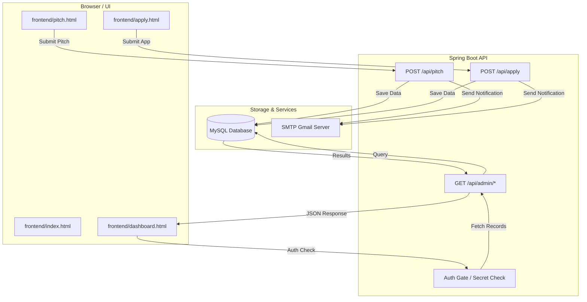

# Rage Labs / Stitch Project

A premium startup platform for submitting pitches, applying for careers, and managing submissions through a high-end admin dashboard. Built with a Spring Boot backend and a modern Tailwind-powered frontend.

## 🚀 Quick Start

### 1. System Requirements
- **JDK 21** or higher
- **Apache Maven 3.8+**
- **MySQL Server 8.0+**
- **Internet Connection** (Required for Tailwind CSS CDN)

### 2. Database Setup
1. Open your MySQL terminal/Workbench.
2. Create the database:
   ```sql
   CREATE DATABASE ragelabsdb;
   ```
3. Ensure the root password matches the configuration in `backend/src/main/resources/application.properties` (Default: `Ronit@123`).

### 3. Running the Backend
1. Navigate to the `backend` directory:
   ```powershell
   cd backend
   ```
2. Run the application:
   ```powershell
   mvn spring-boot:run
   ```
3. Wait for the log: `Started BackendApplication in X seconds`. The API will be available at `http://localhost:8080`.

### 4. Running the Frontend
1. Open `frontend/index.html` in any modern web browser.
2. All forms will automatically communicate with the local backend.

---

## 📊 Data Flow Diagram

The following diagram illustrates how data flows between the user interface, backend services, and storage.



---

## 📂 Project Structure

```text
.
├── backend/            # Spring Boot Java Project
│   ├── src/            # Source code (Controllers, Models, Repositories)
│   ├── pom.xml         # Maven dependencies
│   └── target/         # Compiled build files (Ignore for Git)
├── frontend/           # UI & Web Content
│   ├── assets/         # Global CSS and JS utilities
│   ├── images/         # UI Assets and Branding
│   ├── index.html      # Homepage
│   ├── dashboard.html  # Admin Panel
│   ├── pitch.html      # Startup Pitch Submission
│   └── apply.html      # Career Application
└── RAGELABS_NOTES.txt  # Project notes and credentials (Keep Private!)
```

---

## 🔐 Credentials (Local Reference)
- **Admin Dashboard Password:** `RLA20TWO6`
- **Database Name:** `ragelabsdb`
- **Default Port:** `8080`

---

## 🛠 Tech Stack
- **Frontend:** HTML5, Tailwind CSS (v3), Material Symbols.
- **Backend:** Spring Boot 3, Java 21, Spring Data JPA.
- **Database:** MySQL.
- **Tools:** Maven, Mermaid.js (Diagrams).

---

## 📝 Git Configuration
To ensure a clean repository, a `.gitignore` has been provided to exclude sensitive files, IDE configs, and build artifacts. 

> [!WARNING]
> Before pushing to a public repository (like GitHub), ensure you remove sensitive credentials from `RAGELABS_NOTES.txt` or move them to environment variables.
