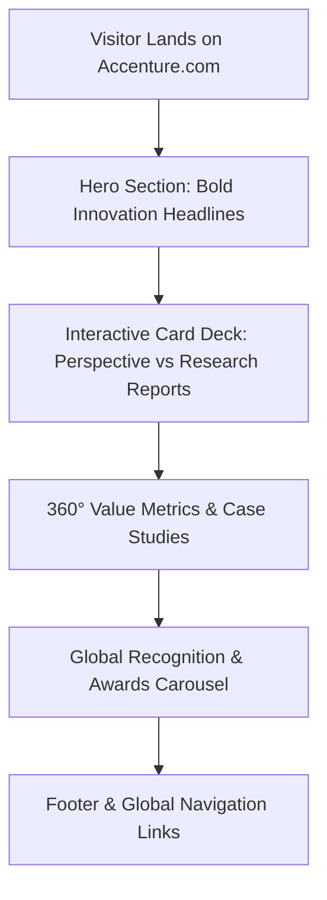

# Comprehensive UI/UX Audit & Review: Accenture.com

**Target Website:** [accenture.com](https://www.accenture.com)  
**Date of Evaluation:** July 2026  
**Auditor:** Antigravity AI (UX/UI Design & Audit Specialist)  
**Overall UI/UX Rating:** **4.4 / 5.0** (Enterprise Premium Standard)

---

## 📋 Executive Summary

Accenture’s digital flagship ([accenture.com](https://www.accenture.com)) exemplifies modern enterprise corporate design. Moving away from traditional corporate white-and-light layouts, Accenture embraces a **sleek, dark-dominant visual identity** highlighted by their signature brand purple (`#A100FF` accent theme) and bold typography. The site serves as both a high-level strategic pitch deck for global executives and a deep resource library for enterprise technology insights.

### Key Takeaways
- **Brand Identity:** High-impact, futuristic, tech-forward dark theme conveying authority, innovation, and enterprise-grade reliability.
- **Navigation Architecture:** Full-width mega-menus organized logically by business capabilities (*What we do*, *What we think*, *Who we are*, *Careers*).
- **Interactive Motion:** Micro-animations, card flip/expand states, and auto-playing carousels with dedicated accessibility pause controls.
- **Areas for Improvement:** Dense card grids can create cognitive overload; secondary text on dark cards requires slightly higher contrast ratio for lower-tier screens.

---

## 🎨 1. Visual Design & Aesthetics (UI Audit)

| Design Element | Assessment & Analysis | Rating |
| :--- | :--- | :---: |
| **Color Palette & Theme** | Dark mode dominance (`#000000` / deep charcoal background) accented by glowing electric violet/purple (`>`) and clean white text. High visual authority. | ⭐⭐⭐⭐⭐ |
| **Typography & Hierarchy** | Custom geometric sans-serif font family (Graphik Accent / Helvetica Neue stack). Oversized headline font sizes ($48\text{px} - 64\text{px}$) with ultra-bold weights establish rapid visual scannability. | ⭐⭐⭐⭐⭐ |
| **Imagery & Illustration** | Hybrid visual approach: minimalist technical vector line illustrations alongside high-contrast neon/violet-tinted photography of professionals and complex machinery. | ⭐⭐⭐⭐☆ |
| **Grid System & Spacing** | Strict 4-column card layouts with clean 24px–32px gutters. High horizontal alignment discipline across responsive viewports. | ⭐⭐⭐⭐☆ |

### Color Breakdown
- **Primary Background:** `#0A0A0A` / `#000000` (Pitch Black / Onyx)
- **Primary Text:** `#FFFFFF` (Pure White) & `#E0E0E0` (Off-white)
- **Brand Accent:** `#A100FF` / `#7500C0` (Accenture Electric Violet)
- **Secondary Surfaces:** `#161616` / `#1F1F1F` (Elevated Card Surfaces)

---

## 🧭 2. Information Architecture & Navigation (UX Audit)

### Header & Mega-Menu System
1. **Logo & Brand Anchoring:** Iconic Accenture right-caret (`>`) logo positioned top-left, acting as an instant home anchor.
2. **Top Navigation Categories:**
   - **What we do:** Covers Services, Technology, Strategy, Operations, Industry solutions.
   - **What we think:** Features thought leadership, research reports, and C-suite insights.
   - **Who we are:** Corporate governance, sustainability (360° Value), leadership, press center.
   - **Careers:** Direct portal for job seekers, culture overview, and hiring journey steps.
3. **Utility Controls:** Dedicated global search icon ($\bigstar$ modal trigger) and country/language localization dropdown selector (e.g., India `en-IN`, US `en-US`).

> [!NOTE]  
> **Mega-Menu Usability:** Expanding menus open smoothly across the viewport without obscuring context aggressively. Active tab indicators (`^` arrows) provide clear feedback on which section is currently expanded.

---

## ⚡ 3. Interactive Elements & Micro-Interactions

1. **Perspective & Research Cards:**
   - Cards feature distinct visual distinction between conceptual line-art (*Perspectives*) and high-fidelity photography (*Research Reports*).
   - Interactive click states flip or reveal deeper article summaries directly on hover/click.
2. **Awards & Recognition Carousel:**
   - Features dynamic progress counter (`5/5`) and prominent left/right chevron navigation buttons.
   - **Accessibility Highlight:** Includes an explicit Play/Pause toggle button in the top-left corner, complying with W3C CAROUSEL usability guidelines for auto-rotating content.
3. **Search Experience:**
   - Clicking search opens an uncluttered, focused overlay search bar with live auto-suggestions and quick topic filters (e.g., *Generative AI*, *Cloud*, *Cybersecurity*).

---

## ♿ 4. Accessibility & Usability (a11y Heuristics)

### Strengths
- **WCAG Contrast Compliance:** Crisp white typography against pitch black background delivers exceptional contrast ($>15:1$ ratio for primary headlines).
- **Motion Pause Controls:** All auto-sliding carousels and background video feeds come with accessible pause mechanics for visual sensitivity.
- **Logical Tab Order:** Keyboard navigation (`Tab` / `Shift+Tab`) cleanly outlines interactive elements with distinct focus rings.

### Areas of Friction
- **Cognitive Density:** Content-heavy sections display up to 4 dense cards side-by-side. For first-time visitors, parsing multiple long titles simultaneously can increase reading effort.
- **Secondary Caption Contrast:** Muted gray captions (`#888888`) inside dark elevated cards fall close to the 4.5:1 minimum threshold under non-ideal monitor brightness settings.

---

## 🎯 5. Strengths vs. Pain Points Summary

### Key Strengths
1. **Unrivaled Enterprise Aesthetic:** Feels modern, authoritative, and futuristic—delivering on the tagline *"Let There Be Change"*.
2. **Clear Content Categorization:** Well-structured mega-menus allow enterprise buyers, job applicants, and investors to self-segment within 1 click.
3. **Strong Motion Discipline:** Micro-animations (caret accents, card lift effects) add elegance without hindering page performance.

### Pain Points
1. **High Visual Density:** Requires frequent scrolling to digest extensive research reports and insights.
2. **Dropdown Persistence:** Switching rapidly between mega-menu headers via hover can occasionally trigger accidental menu switching.

---

## 🚀 6. Strategic Recommendations

1. **Introduce Micro-Filters for Home Page Cards:** Allow users to filter home page insight cards by topic (e.g., *AI*, *Cloud*, *Sustainability*) to reduce cognitive overload.
2. **Enhance Secondary Text Contrast:** Elevate dark card body text from `#888888` to `#AAAAAA` to ensure 100% compliance across low-brightness mobile screens.
3. **Mobile-First Card Stacking:** On tablet/mobile breakpoints, convert 4-column card rows into swipeable snap-scroll cards with visible pagination dots.

---

*Report generated by Antigravity AI UI/UX Audit Suite.*
